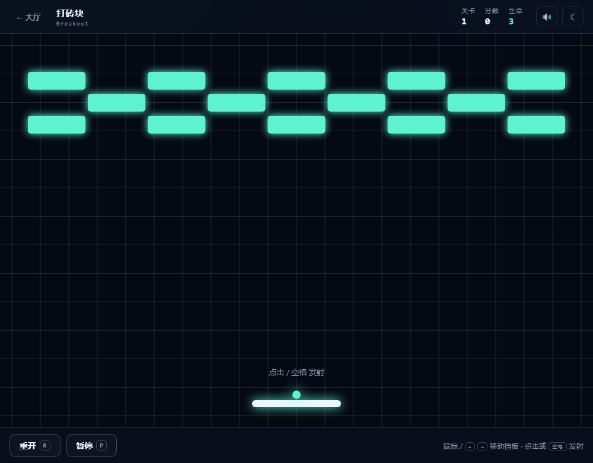
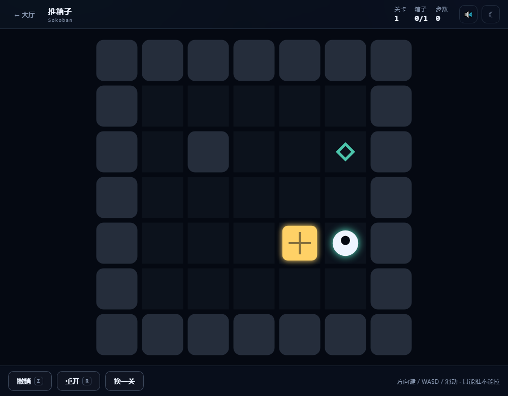
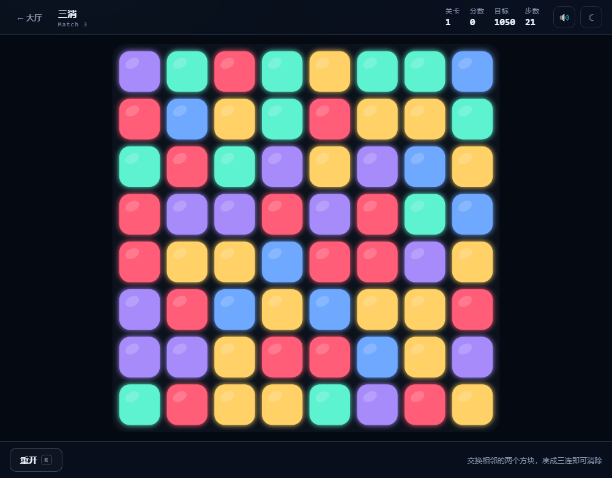

# 经典小游戏合集 · Classic Arcade

十二个经典小游戏，全部**零依赖、零构建、纯前端**，双击 `index.html` 就能玩，
也可以直接丢到 GitHub Pages / 任意静态服务器上。

风格沿用另一个项目 arrow-maze 的霓虹极简：深色底 + 青绿高光，可一键切换白天纸感主题。


| 打砖块 | 推箱子 | 三消 |
| --- | --- | --- |
|  |  |  |

## 游戏列表

| 分类 | 游戏 | 玩法 |
| --- | --- | --- |
| 街机动作 | 打砖块 Breakout | 挡板弹球打碎砖块，砖块有硬度，关卡无限 |
| 街机动作 | 太空侵略者 Invaders | 自动开火，捡 P 升级武器：双发 / 三发 / S 弹 / 激光 |
| 街机动作 | 僵尸围城 Zombie Defense | 自动瞄准守基地，升级三选一，无限波次 |
| 街机动作 | 贪吃蛇 · 迷宫 Snake | 每关一张新迷宫，吃满目标长度过关 |
| 益智解谜 | 推箱子 Sokoban | 反向生成保证可解，只能推不能拉，支持撤销 |
| 益智解谜 | 数独 Sudoku | 唯一解生成，线索逐关减少；笔记模式、撤销、提示 |
| 益智解谜 | 一笔画 · 连线 Flow | 半自动生成，要求连线不交叉且铺满全盘 |
| 益智解谜 | 冰面滑行 Ice Slide | 一滑到底，撞石头才停，收集全部宝石 |
| 益智解谜 | 激光反射 Laser Mirror | 点击镜子旋转，把光束引到所有目标 |
| 休闲消除 | 扫雷 Minesweeper | 首点必安全，长按 / 右键插旗，限时闯关 |
| 休闲消除 | 2048 | 在步数用尽前合出目标方块 |
| 休闲消除 | 三消 Match 3 | 交换相邻方块，在步数内达到目标分 |

所有游戏都是**关卡制**：过关后进入下一关，难度逐级上升；
进度保存在 `localStorage`（键名前缀 `cg:`），大厅卡片上会显示「最高 第 N 关」。

## 本地运行

方式一：双击 `index.html`（全部是普通 `<script>`，不是 ES Module，`file://` 也能跑）。

方式二：起一个静态服务器（行为和线上一致）：

```bash
cd classic-games
node tools/serve.mjs 8123     # 自带的小服务器，没有依赖
# 或者 npx serve .  /  python -m http.server 8080
```

## 目录结构

```
classic-games/
├── index.html               # 门户：分类筛选 + 卡片入口
├── assets/
│   ├── css/theme.css        # 双主题、卡片、HUD、弹层、工具栏
│   └── js/core.js           # 存储 / 主题 / 音效 / 弹层 / 画布适配 / 进度
├── games/
│   ├── breakout/index.html
│   ├── invaders/index.html
│   ├── zombies/index.html
│   ├── snake/index.html
│   ├── sokoban/index.html
│   ├── sudoku/index.html
│   ├── flow/index.html
│   ├── ice/index.html
│   ├── lasers/index.html
│   ├── mines/index.html
│   ├── 2048/index.html
│   └── match3/index.html
├── tools/check.mjs          # 真浏览器自检：控制台报错 + 交互 + 通关 + 截图
└── .gitattributes           # 统一 LF，避免 Windows 换行污染
```

单个游戏是完全自包含的一个 HTML 文件，只有共享样式和 `core.js` 是外部依赖，
复制走一个目录即可单独部署。

## 部署到 GitHub Pages

仓库：<https://github.com/QGuo2020/classic-games>

推送后只要在仓库里打开一次 Pages 开关即可：

1. **Settings → Pages**
2. Source 选 **Deploy from a branch**
3. Branch 选 **main**，Folder 选 **/ (root)**
4. 保存，等 1~2 分钟，访问：

```text
https://qguo2020.github.io/classic-games/
```

不需要任何构建或 CI：仓库根目录就是站点根目录，GitHub 会原样发布。
之后每次 `git push` 都会在几十秒内自动更新。

所有路径都是相对路径（`./assets/...`、`../../assets/...`），
所以放在 `/classic-games/` 这种子路径下也能正常工作，不需要改配置。

> Pages 需要仓库为 public（免费账号）；如果打开后看到旧页面，按 `Ctrl + F5` 强刷。
> 以后想改用 GitHub Actions 部署，再加一个 `upload-pages-artifact` 工作流即可，
> 现在这套纯静态结构两种方式都兼容。

### 本地预览

```bash
cd classic-games
npx serve .                # 或 python -m http.server 8080
```

## 技术要点

- **零依赖**：没有 npm 包、没有构建步骤；`core.js` 只是几十 KB 的普通脚本。
- **一套外壳**：`theme.css` 提供 HUD、工具栏、弹层、双主题；`core.js` 提供
  `CG.store` / `CG.theme` / `CG.sfx` / `CG.ui.modal` / `CG.util.grid` / `CG.progress`。
- **确定性关卡**：`CG.util.rng(seed)` 是 mulberry32，同一关卡重开布局一致。
- **可解性**：推箱子用「从已解状态反向拉箱子」生成，逆向序列即解法；
  一笔画先生成哈密顿路径再切段，保证存在铺满解；冰面滑行只在 BFS 可达的停靠点放宝石。
- **输入**：键盘（方向键 / WASD / 空格 / R / P）、鼠标、触屏滑动与长按都支持。

## 自检

```bash
node tools/check.mjs
```

会起一个本地静态服务器 + 无头 Chrome（DevTools 协议，不需要装 puppeteer），跑 103 项检查：

1. 门户 + 12 个游戏 + 404 页逐个打开：控制台零报错、canvas 真的画了东西；
2. 交互测试（读游戏内部状态，不只看像素）：打砖块发射后球真的在飞、且不会瞬间清屏；
   太空侵略者不用按键自动开火、武器升级链完整、粗激光真的能击杀、捡 P 自动升级、装甲兵；
   僵尸围城自动刷怪与开火、僵尸摸基地会扣血、升级三选一；
   贪吃蛇开局待命、按键才动；推箱子能走过去把箱子推走；冰面滑行一滑到底；
   扫雷首点安全；2048 移动后棋盘变化；数独终盘合法、输入、撤销、填满过关；
3. 通关测试：一笔画按生成器解法整条拖完必须过关并能点「下一关」，
   另外验证「线都连上但没铺满」时会明确提示还差几格；
   三消找出可消除的交换必须加分；激光转到解法朝向必须点亮全部目标；
4. 随机输入压力测试：每个游戏随机按键 / 点击 3.5 秒，扫描游戏状态里有没有 NaN / Infinity；
5. 产出截图到 `docs/shots/`（含亮色主题和移动端布局）。

脚本里的端口是动态分配的，退出时会 `taskkill` 掉整棵 Chrome 进程树，不会留下后台进程。

> 调试钩子：每个游戏都在 `window.__game` 上暴露了自己的状态对象
> （另外 `__flow` / `__match3` / `__lasers` / `__breakout` 也保留），
> 可以在控制台里直接看当前关卡、球坐标、棋盘等，不影响正常游玩。

